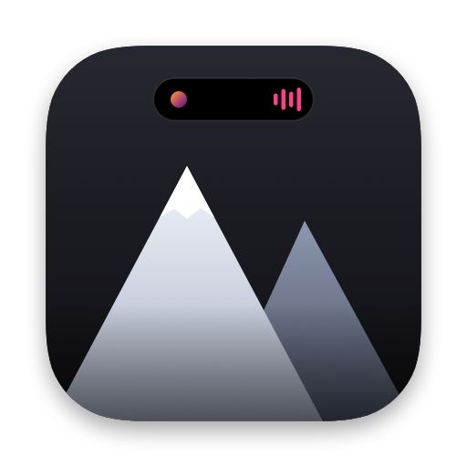
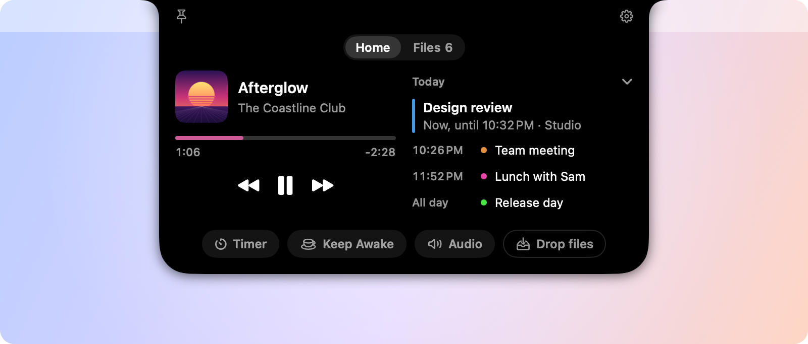
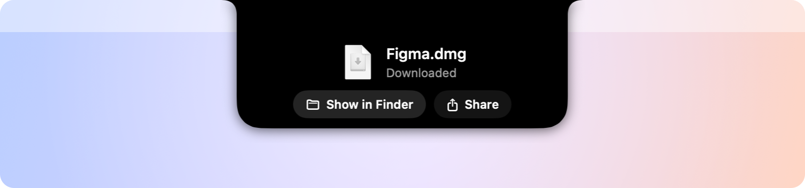
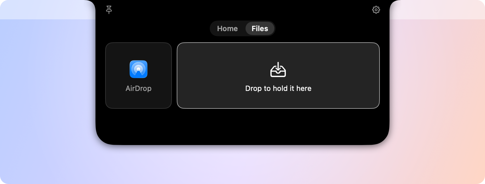

  

<h1 align="center">Peak</h1>

  <b>Your MacBook's notch, alive.</b> 
  What's playing, today's calendar, a call, downloads and timers at the top of your screen, 
  a place to hold files for a while, and window snapping. Out of the way until you hover it.

  <a href="https://github.com/TJDubbs04/peak/releases/latest"><b>Download Peak</b></a>
  &nbsp;·&nbsp; Free &nbsp;·&nbsp; macOS 14 or later &nbsp;·&nbsp; Macs with a notch

  

## What Peak does

### Out of the way until something's going on

Tucked away, Peak is the notch, a little wider, like the Dynamic Island on an iPhone. When something's going on, it
shows beside the notch: the song playing (its cover and moving bars), a meeting about to start, a call, a download, a
timer, or your Mac being kept awake.

  

### Hover the notch to open it

**Home** is what's going on, always in the same order:

- **The song playing**, from Music, Spotify, your browser or any app that shows in Control Center's Now Playing, with
  its cover (or a video's thumbnail), play and pause, next and previous, and a bar you can drag through it.
- **Today**, from your calendar: what's on now and next, with **Join** for online meetings.
- **What's under way:** a call (with **Mute**), downloads, timers and Keep Awake.
- **Quick actions:** a **Timer**, **Keep Awake** (your Mac won't sleep for a while) and **Audio** (the volume, the
  microphone and the devices they use).

Click Peak (or its pin) to keep it open until you click somewhere else.

### Moments that come and go

A new song, a finished download, a timer that's done, a new screenshot, a charger plugged in, the volume changing,
headphones connecting, a meeting starting. Each one shows for a moment and goes by itself; nothing piles up.

  
  
  

### Hold files for a while

Drag files, folders, links or text onto the notch to hold them in **Files**, then drag them back out wherever you need
them. Dragging out always makes a copy, and the original never moves. Drop on **AirDrop** to send straight away. New
screenshots and finished downloads show up there too, ready to drag into another app.

  

### Snap windows at the notch

Drag a window toward the notch and six layouts appear: halves, thirds, 70/30, quarters and more. Drop it on the zone you
want, then pick windows for the rest of the layout. **⌃⌥** with an arrow, **U I J K**, **D F G** or **Return** snaps the
window in front from the keyboard.

  

## Install

1. [Download](https://github.com/TJDubbs04/peak/releases/latest) `Peak-<version>.dmg` from the latest release.
2. Open it and drag **Peak** onto **Applications**.
3. Open Peak from Applications.

Peak has no Dock icon: it lives at the notch and in the menu bar (the mountain icon). The first time, the notch says
**Peak is ready**, with **Open at Login** so it starts with your Mac. Peak is signed and notarized by Apple.

**Requirements:** a Mac with a notch (MacBook Pro 14-inch or 16-inch, 2021 and later, or MacBook Air, M2 and later) and
macOS 14 Sonoma or later. On a display without a notch, Peak waits in the menu bar.

## Permissions

Peak asks only when a feature first needs something, and keeps working if you say no.

| What | When | What it's for |
|---|---|---|
| Calendar | The first time Peak opens | Today on Home, and meetings about to start |
| Automation (Music, Spotify) | The first time you use their controls | Play, pause, next and previous |
| Accessibility | The first time you snap a window | Moving and resizing windows |

Peak never asks to record your screen, use your camera or microphone, or watch your keyboard. More in the
[user guide](docs/USER_GUIDE.md#permissions).

## Privacy

Peak runs on your Mac and keeps what it knows there: no accounts, no analytics, no tracking, no ads. The one thing it
fetches from the internet is Spotify's album art, from Spotify. It sees which apps use the microphone (to know a call is
under way), never what it hears. Everything it reads, keeps and sends: [Privacy](docs/PRIVACY.md).

## Questions

<b>Is Peak really free?</b>

Yes. No accounts, no subscriptions, nothing locked away.

<b>Does it work on a Mac without a notch?</b>

No. Peak lives in the notch, so on a display without one (or with the lid closed and only an external display in
use) it waits in the menu bar, and its menu says why.

<b>How do I update it?</b>

Settings › About › **Check for Updates…** opens the releases page. Quit Peak, then drag the new version onto
Applications, replacing the old one. Your settings and held files stay.

<b>A song or video in my browser doesn't show.</b>

Peak shows what macOS shows in Control Center's Now Playing, one app at a time. Pressing play in the browser again
usually brings it back.

<b>Why do ads in a video show like videos?</b>

That's how websites report them to macOS: an ad arrives as a short video of its own. Peak doesn't pop up for them, and
your video coming back after an ad doesn't pop up either.

<b>How do I uninstall it?</b>

Turn off **Open at login** in Settings, quit Peak from the menu bar, and drag it from Applications to the Trash. To
remove what it kept too, see the [user guide](docs/USER_GUIDE.md#uninstalling).

More in the [user guide](docs/USER_GUIDE.md): every feature, settings, troubleshooting.

## Report a problem or share an idea

[Open an issue](https://github.com/TJDubbs04/peak/issues/new/choose). For a problem, include your Peak version
(Settings › About), your macOS version and your Mac model, and how to make it happen.

## About

Peak is made by Wetzel Developments, and is free to use. This repository holds its downloads, documentation and issue
tracker. [Changelog](CHANGELOG.md) · [Third-party notices](THIRD_PARTY_NOTICES.md)

© 2026 Wetzel Developments.
